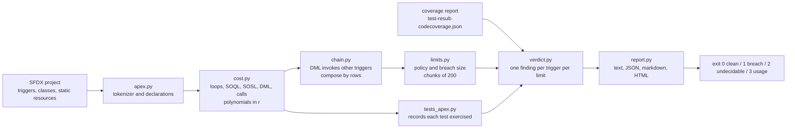
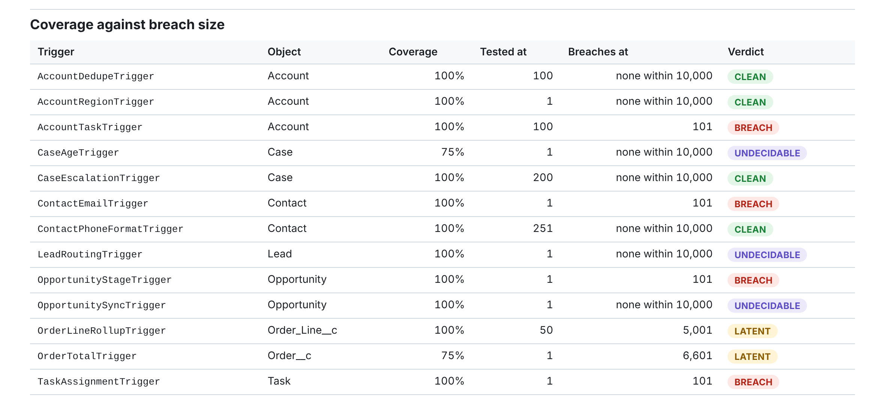

# apex-bulk-safety-gate

**Computes, for every trigger in an SFDX project, the record count at which it breaches a governor limit, and places that number next to the largest record count any test actually exercised, which line coverage cannot show.**

[](https://github.com/ManojKumarChunduru/apex-bulk-safety-gate/actions/workflows/ci.yml)


## The thing coverage cannot tell you

A line coverage percentage is a property of lines. A governor limit is a property of counts. A test that inserts one Account covers the SOQL inside `for (Account a : Trigger.new)` exactly as a 200-record test would, and the deploy accepts 100% either way. The limit breaches at the 101st record, which no line-level artefact can represent.

Four questions this answers that a coverage report does not:

1. For each trigger, at how many records does it breach, and which limit goes first: 100 SOQL queries, 20 SOSL queries, 150 DML statements or 10,000 DML rows?
2. How many records did the tests behind it actually push through, so a verdict of "clean" carries its own resolution?
3. Which breaches are in a trigger the DML invokes rather than the one you are reading, so a bulkified Account trigger inserting one Task per account breaches inside the Task trigger?
4. Which triggers can the gate not bound at all, and why?

## The numbers, uncomfortable ones first

On the committed fixture (13 triggers over 8 objects, declared coverage, 12 Apex test methods):

- **4 of 11 fully covered triggers breach at 200 records (36.4% of the fully covered).** The tests behind them exercise at most 100 records. The closest miss is `AccountTaskTrigger`, tested at 100 records and breaches at 101: 1 record short.
- **2 breaches above 200 records, in triggers that are correctly bulkified.** `OrderLineRollupTrigger` and `OrderTotalTrigger` cost a constant number of queries per invocation, which is the right shape, and still breach inside one Bulk API batch, the smaller at 5,001 records and the larger at 6,601 records, because chunks of 200 share one transaction's limits. The 200-record test every bulkification guide recommends cannot see either.
- **3 of 13 triggers undecidable (23.1% of the fixture undecidable).** Dynamic dispatch through `Type.forName`, a handler in a namespace that is not in the project, and a trigger that updates its own object with no static guard. The gate reports these first and never costs them as zero. The coverage report calls 2 fully covered triggers undecidable.
- 3 breaches through a chain, out of 7 breaches in all, and 2 exist only through the chain: the trigger that breaches contains no query.

Credibility line: 309 tests, 99.3% line coverage, 0 runtime dependencies, 7 planted breaches recovered with 7 true positives, 0 false positives and 0 false negatives against a ground truth written before the gate ran (resolution floor: a measured zero is below one in 7, and the fixture is the author's). Every number in this document is re-measured by `make verify` and checked against the prose by `tools/check_numbers.py`.

## Quickstart

Prerequisites: Python 3.11 or later, git. No Salesforce org, no CLI, no network at runtime.

```bash
git clone https://github.com/ManojKumarChunduru/apex-bulk-safety-gate.git
cd apex-bulk-safety-gate
python -m pip install -e ".[dev]"

# the headline table: coverage, tested size, breach size, verdict. Exit 1 on the fixture.
absg gate --project fixture --coverage fixture/coverage/test-result-codecoverage.json

# the arithmetic for one trigger, site by site
absg explain AccountTaskTrigger --project fixture

# the same project at one Bulk API batch: the latent breaches become breaches
absg gate --project fixture --records 10000

make verify   # lint, tests, experiments, receipts
```

To add it to a pipeline, run it after the test step that produces the coverage file:

```yaml
- run: python -m pip install git+https://github.com/ManojKumarChunduru/apex-bulk-safety-gate.git
- run: absg gate --project . --coverage coverage/test-result-codecoverage.json
```

The repository's own workflow does this on the fixture and expects exit 1.

## Claim 1: coverage and bulk safety are unrelated properties

| Coverage bucket | breach | latent | clean | undecidable |
| --- | --- | --- | --- | --- |
| 100% | 4 | 1 | 4 | 2 |
| 75 to 99% | 0 | 1 | 0 | 1 |

The 11 triggers at 100% coverage split four ways. Coverage says which lines a test reached; the breach size says how many records it takes to reach a limit, and the two numbers are computed from different things. The declared coverage report is a fixture input (see what this cannot measure), but the shape of the table does not depend on which triggers were given which percentage: every breaching trigger in the fixture would be 100% covered by a one-record test, because a one-record test runs every line a 200-record test runs.

The experiment: `experiments/exp02_coverage_vs_bulk.py`, output in `docs/experiments/exp02_coverage_vs_bulk.json`.

## Claim 2: the tests' resolution is the number that matters, and it is published

| Trigger | Limit | Tested at | Breaches at | Short by | A 200-record test |
| --- | --- | --- | --- | --- | --- |
| `AccountTaskTrigger` | SOQL queries | 100 | 101 | 1 | reaches it |
| `ContactEmailTrigger` | SOQL queries | 1 | 101 | 100 | reaches it |
| `ContactEmailTrigger` | DML statements | 1 | 151 | 150 | reaches it |
| `OpportunityStageTrigger` | SOQL queries | 1 | 101 | 100 | reaches it |
| `OrderLineRollupTrigger` | SOQL queries | 50 | 5,001 | 4,951 | misses it |
| `OrderTotalTrigger` | SOQL queries | 1 | 6,601 | 6,600 | misses it |
| `TaskAssignmentTrigger` | SOQL queries | 1 | 101 | 100 | reaches it |

8 of 12 Apex test methods exercise one record, and 2 exercise 200 or more. The largest test anywhere exercises 251 records, on a trigger with no cost at any record count. Of the 7 breaches, 5 breaches at or below 200 would be surfaced by a 200-record test; the 2 breaches above 200 would not, and the table says how many records each would take. A verdict of "clean" from a test at N records is a claim about N records: the gate never reports a clean trigger without the tested size beside it.

What this costs against what it buys: the gate reads the tests as source, so a test that builds its records in a way the reader cannot bound (a query result, a method return value) is reported as unknown rather than counted. In the fixture every test is bounded; in a real project the unknown column is the first thing to look at.

The experiment: `experiments/exp03_resolution.py`.

## Claim 3: the breach is often in a trigger you are not reading

`AccountTaskTrigger` contains one DML statement and no query. `TaskAssignmentTrigger`, which that statement invokes, runs one query per task. The gate composes the Task trigger's cost polynomial with the rows the Account trigger's statement carries (r rows, one per account), so the Account trigger costs r queries per invocation and breaches at 101 accounts. `ContactEmailTrigger` is the mirror case: a bulkified Case trigger that costs one query per invocation is invoked once per contact, because the Contact trigger issues its insert inside the loop, and the one query becomes r.

Per-record cost is a polynomial in r, the records in one invocation, rather than a flag. A nested loop over trigger records is r squared. A loop over three constant statuses is 3. Chains compose by substitution. Cost at R records is the sum over chunks of 200, so a constant cost per invocation still has a breach size: 3 queries per invocation exceed 100 queries at the 34th chunk, the 6,601st record.

The experiment: `experiments/exp01_breach_census.py`.

## Claim 4: the gate counts what it refuses

3 refusal reasons appear in the fixture, with the construct and line for each:

| Trigger | Reason | Construct |
| --- | --- | --- |
| `CaseAgeTrigger` | reentrant | `update Case` re-enters the trigger with no static guard |
| `LeadRoutingTrigger` | dynamic_dispatch | `Type.forName(...)` chooses the handler at runtime |
| `OpportunitySyncTrigger` | external_namespace | `erp.SyncHandler.push()` is in a managed package |

The full refusal vocabulary is in ADR-002: dynamic dispatch, a namespace outside the project, a cost inside a loop the source does not bound, a DML target the reader cannot type, rows the source does not bound, recursion, and re-entry without a guard. A trigger with any refusal is undecidable regardless of what its bounded part says, and the exit code separates "undecidable" (2) from "breach" (1) so a pipeline can decide what to do with each. The guarded re-entrant trigger (`AccountRegionTrigger`, behind `RecursionGuard.regionRan`) is bounded; the unguarded one is not.

The experiment: `experiments/exp04_undecidable.py`.

## The bugs the measurement found

**The add that was also a call.** On the first run against the fixture, `AccountTaskTrigger` reported clean and every Apex test read as exercising one record, including the 100, 200 and 251-record ones. `tasks.add(...)` is both a method call on a variable and the way a collection grows, and the reader handled the call first and stepped past the growth, so `insert tasks` carried zero rows. The growth now happens inside the qualified-call path; the test `test_a_collection_grown_by_add_is_seen_even_though_add_is_a_qualified_call` pins it with the story in its docstring.

**The static field that read as a foreign namespace.** `REGIONS.get(country)` inside `RegionLookup` was refused as `external_namespace`, which made the guarded trigger undecidable instead of clean. A static field of the owning class is now resolved before a bare identifier is treated as a namespace, and a custom setting's `getInstance()` is a platform call rather than a refusal. The same pass found that `erp.SyncHandler.push()` was slipping through as zero cost, because the three-segment chain was read as two unrelated two-segment calls; it is now a refusal in its own right (ADR-002).

**The test count typed before it was measured.** The suite commit message said one number and `pytest --co` said another, and the message was amended. The collector reads the count from the junit file for the same reason: a number typed by hand goes stale without anyone noticing.

## Architecture



Rendered by `tools/render_architecture.py` from this source (not a live Mermaid fence, see ADR-004's note on GitHub rendering):



## Evidence



The three screenshots in `docs/evidence/` are generated by `tools/capture_screenshots.py` from the HTML report the gate writes, framed by section heading rather than by pixel offset, and the tool reads back the computed style of the verdict badge and fails if it is invisible (`docs/evidence/screenshots.json` records the reading).


The GIF is a replay of captured stdout paced by measured wall time, not a screen recording; `docs/evidence/manifest.json` lists every command with its exit code, and `docs/evidence/demo.mp4` is the same replay at full quality.

## The fixture

`fixture/` is a real SFDX project: 13 triggers over 8 objects (Account, Contact, Opportunity, Case, Lead, Task, `Order__c`, `Order_Line__c`), 8 handler and helper classes, 7 test classes with 12 Apex test methods, one 50-row CSV static resource used by `Test.loadData`, and a declared coverage report. `fixture/EXPECTED_FINDINGS.json` is the ground truth, written from the source before the gate ran; a test asserts the report equals it exactly.

The awkward cases are the point:

- `OrderTotalTrigger` has a query inside a loop, which every line-based rule flags; the loop is over three constant statuses and costs 3 queries per invocation. It is clean at 200 records and breaches at 6,601.
- `AccountRegionTrigger` and `CaseAgeTrigger` both update their own object. One has a static guard and is bounded; the other does not and is undecidable.
- `LeadRoutingTrigger`'s real handler, `LeadRouter`, is in the project and costs one query per lead. The gate cannot see it through `Type.forName` and says so rather than guessing.
- The 100-record Account test stops one record short of the chain breach at 101. It would pass in an org, and it proves nothing about the 101st record.

Of the 13 triggers in the fixture, 4 triggers breach at 200 records, 2 breach only above 200, 4 clean within the horizon of 10,000 records, and 3 of 13 triggers undecidable. The gate's table, verdict at 200 records:

| Trigger | Object | Coverage | Tested at | Breaches at | Verdict |
| --- | --- | --- | --- | --- | --- |
| `AccountDedupeTrigger` | Account | 100% | 100 | none within 10,000 | clean |
| `AccountRegionTrigger` | Account | 100% | 1 | none within 10,000 | clean |
| `AccountTaskTrigger` | Account | 100% | 100 | 101 | breach |
| `CaseAgeTrigger` | Case | 75% | 1 | none within 10,000 | undecidable |
| `CaseEscalationTrigger` | Case | 100% | 200 | none within 10,000 | clean |
| `ContactEmailTrigger` | Contact | 100% | 1 | 101 | breach |
| `ContactPhoneFormatTrigger` | Contact | 100% | 251 | none within 10,000 | clean |
| `LeadRoutingTrigger` | Lead | 100% | 1 | none within 10,000 | undecidable |
| `OpportunityStageTrigger` | Opportunity | 100% | 1 | 101 | breach |
| `OpportunitySyncTrigger` | Opportunity | 100% | 1 | none within 10,000 | undecidable |
| `OrderLineRollupTrigger` | Order_Line__c | 100% | 50 | 5,001 | latent |
| `OrderTotalTrigger` | Order__c | 75% | 1 | 6,601 | latent |
| `TaskAssignmentTrigger` | Task | 100% | 1 | 101 | breach |

`fixture/README.md` lists every planted case with the file that carries it.

## What this cannot measure

- **The coverage report is declared, not observed.** `fixture/coverage/test-result-codecoverage.json` is hand-written in the shape that `sf apex run test --code-coverage --output-dir` produces, as far as this build could verify that shape from documentation. The gate validates the file at the boundary and would read a real one the same way, but no CLI run produced the fixture's copy.
- **The breach point is declared from the limits table.** That a trigger issuing its 101st query throws `System.LimitException` is taken from the documented limit of 100 SOQL queries per synchronous transaction (200 for asynchronous), not observed in an org. The one experiment that would settle it is in ADR-005.
- **Chunk sharing above 200 records is declared.** The documentation states that triggers process batches of 200 and that limits are per transaction; the arithmetic above 200 assumes the chunks of one DML share one transaction's limits. The `--records` figures above 200 carry that assumption, and the horizon of 10,000 records is one Bulk API batch.
- **CPU time is excluded.** It is a duration, it moves with the machine, and nothing in this repository publishes one.
- **Query rows are not bounded.** The 50,000-row limit depends on data, not source, so it is not in the policy and not in any verdict.
- **The fixture is the author's.** Precision and recall against a ground truth the same person wrote are checks on parsing and arithmetic, not on what the gate would find in code it has never seen.

ADR-005 lists each of these with the scratch org experiment that would turn it from declared into observed, in the order they are worth running.

## Layout, exit codes, reproduction

```
src/absg/        apex.py (tokenizer, declarations), provenance.py (polynomials in r),
                 cost.py (the reader), chain.py (DML into other triggers), limits.py (policy,
                 breach size), tests_apex.py (records each test exercised), coverage.py,
                 verdict.py, report.py, cli.py, exit_codes.py
fixture/         the SFDX project, the declared coverage report, EXPECTED_FINDINGS.json
experiments/     exp01 to exp04, writing docs/experiments/*.json
tools/           collect_metrics.py, check_numbers.py, render_architecture.py,
                 capture_screenshots.py, record_demo.py
docs/            adr/, metrics.json, assets/, evidence/
tests/           309 tests named as properties
```

Exit codes: 0 every trigger bounded and none breaches at the configured record count; 1 at least one trigger breaches; 2 no breach found but at least one trigger could not be bounded, so "clean" cannot be asserted; 3 usage, including an unreadable project, a malformed coverage report or an unknown policy key. The distinction between 1 and 2 is the interface: a pipeline that treats both as red teaches people to delete the step, and one that treats 2 as green asserts a cleanliness nobody measured.

Make targets: `install`, `lint`, `test`, `gate`, `explain`, `experiments`, `receipts`, `evidence`, `verify`. `make verify` runs lint, tests, experiments and receipts from a fresh clone with no network. The receipts step re-measures every figure into `docs/metrics.json` and `tools/check_numbers.py` holds the documents to it by anchor phrase rather than by digit, so "4 of 11 fully covered triggers breach" is checked as a phrase and "4" alone proves nothing; it also lists any number in this README that no metric accounts for.

## Tech stack

| Technology | Role | Why here, specifically |
| --- | --- | --- |
| Python 3.11+, standard library only at runtime | the gate | a PR gate runs on a pipeline runner that has Python and nothing else; nothing to install, one step to add |
| A purpose-built reader for the costing subset of Apex | extraction | the question needs loops, queries, DML and calls, not the grammar; what the reader does not understand it refuses rather than costs as zero (ADR-002) |
| `json`, `csv`, `xml.etree` | inputs | the project manifest, the coverage report, the static resource and the metadata files are all stdlib formats |
| `argparse` | CLI | boring on purpose; the exit codes are the interface (ADR-004) |
| pytest, coverage, ruff | tests and lint | a tool that argues coverage is insufficient has to publish its own: 309 tests, 99.3% line coverage |
| GitHub Actions | CI and the gate's own use case | the workflow runs the gate on the fixture as a PR check and expects exit 1 |
| Committed SFDX fixture with a declared coverage report | the corpus | an org cannot be committed; a fixture with planted breach sizes can, and it makes every figure reproducible offline |
| Playwright, ffmpeg (evidence only) | screenshots and the replay | never on the runtime path; `make verify` does not need them |

## Decisions

- [ADR-001: verdict by count provenance, not by line coverage](docs/adr/ADR-001-count-provenance-not-line-coverage.md)
- [ADR-002: a purpose-built reader with a stated refusal set, not a full parser and not an org](docs/adr/ADR-002-purpose-built-extractor-with-a-refusal-set.md)
- [ADR-003: report the breach size, not a boolean at 200](docs/adr/ADR-003-breach-size-not-a-boolean.md)
- [ADR-004: standard library only, and limits in a policy file with the reason beside each](docs/adr/ADR-004-standard-library-and-a-limits-policy.md)
- [ADR-005: what a committed fixture cannot establish](docs/adr/ADR-005-what-a-committed-fixture-cannot-establish.md)

## The Pivot, and what a v2 needs

Out of scope: generating the missing bulk test class for each breaching trigger, a scaffold that inserts breach-size records and asserts no `LimitException`. The trigger for adding it is the first team that runs the gate as a backlog report rather than a PR gate and wants a pull request per finding rather than a table. Until then, the gate reports and exits.

Also out of scope: an `--org` mode that retrieves metadata and runs the tests for an observed coverage report. ADR-005 says what that mode would settle.

A v2 would need, in order:

1. The scratch org experiment from ADR-005, so the breach point and the chunk arithmetic are observed rather than declared. First metric to watch: the number of planted breaches at which the org throws exactly where the gate said.
2. A second fixture written by someone other than the gate's author, to find cost shapes the reader does not model.
3. Flow-invoked Apex and Flow DML in the chain, since a record-triggered Flow that calls an invocable method is a trigger in everything but name.
4. Conditional branches costed as alternatives rather than as a sum, which today overcounts an `if` / `else` that both issue a query.
5. An async context switch per trigger, since `@future` and `Queueable` bodies run under the 200 for asynchronous SOQL limit rather than 100.
